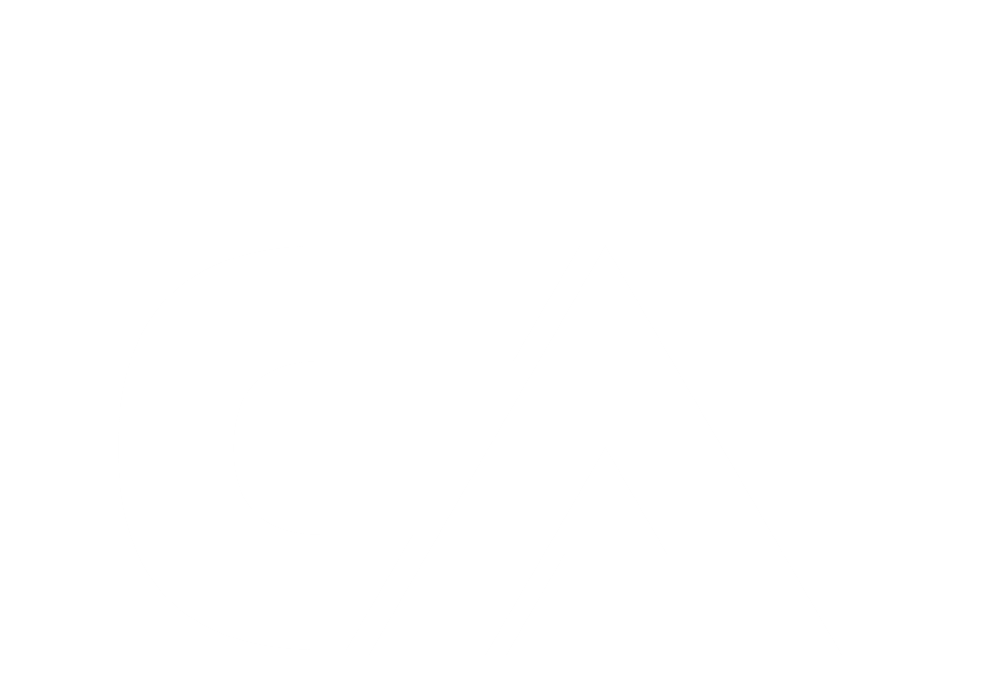
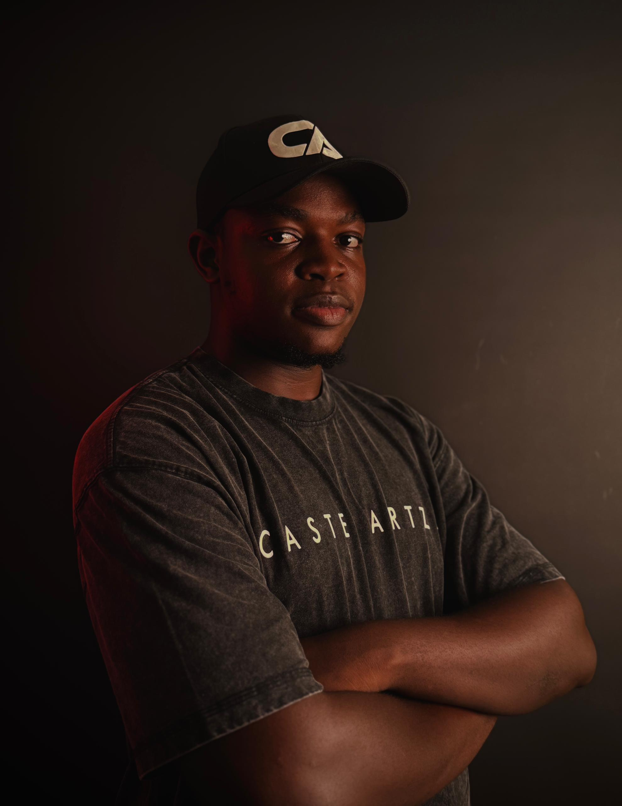

<!doctype html>
<html lang="en">
<head>
<meta charset="UTF-8">
<meta name="viewport" content="width=device-width,initial-scale=1">
<meta name="referrer" content="strict-origin-when-cross-origin">
<meta name="theme-color" content="#090a0c">
<meta name="description" content="Casten Artzz is a video content creator and UGC creator making natural, engaging content for brands and digital platforms.">
<title>Casten Artzz | Video Content Creator &amp; UGC Creator</title>
<link rel="preconnect" href="https://fonts.googleapis.com">
<link rel="preconnect" href="https://fonts.gstatic.com" crossorigin>
<link href="https://fonts.googleapis.com/css2?family=DM+Sans:wght@400;500;600;700;800&family=Manrope:wght@400;500;600;700;800&display=swap" rel="stylesheet">

</head>
<body>
<header class="site-header">

<a class="brand" href="#home">CASTENARTZZ</a>
<nav class="nav-links" id="mainNav" aria-label="Main navigation"><a href="#work">Work</a><a href="#about">About</a><a href="#services">Services</a><a href="#contact">Contact</a></nav>
<a class="nav-cta" href="#contact">LET'S TALK ↗</a><button class="menu-toggle" id="menuToggle" aria-label="Open navigation" aria-expanded="false">☰</button>

</header>
<main>
<section class="hero" id="home">

VIDEO CREATOR &nbsp;·&nbsp; UGC CREATOR
<h1>I'm Casten Artzz.</h1>
Content that feels real. Stories that connect.

I'm a video content creator and UGC creator making natural, engaging videos for brands, products and digital platforms — from talking head videos and product demos to explainers and short form content.

<a class="btn btn-primary" href="#work">Explore My Work ↗</a><a class="btn btn-outline" href="contact.html">Work With Me</a>

VIDEO CREATOR · UGC
CREATIVE PORTFOLIO — 2026

</section>

<strong>UGC</strong>Creator led content

<strong>Short form</strong>Social-first videos

<strong>Brand</strong>Storytelling &amp; content

<section class="section brands-section" id="brands">

COLLABORATIONS
<h2>Brands I have created for.</h2>

A selection of brands and projects I have supported through creator led video content.

<button class="brand-card" data-filter="willo"><h3>Willo.ai</h3>
UGC &amp; short form content
Explore project ↗</button>
<button class="brand-card" data-filter="jarveyai"><h3>JarveyAI</h3>
UGC &amp; short form content
Explore project ↗</button>
<button class="brand-card" data-filter="keyframe"><h3>keyfraME</h3>
UGC &amp; short form content
Explore project ↗</button>
<button class="brand-card" data-filter="BlogsEo"><h3>BlogsEo</h3>
UGC &amp; short form content
Explore project ↗</button>

</section>
<section class="section" id="work">

<button type="button" class="portfolio-switch-btn active" id="ugcTab" role="tab" aria-selected="true" aria-controls="ugcPortfolioPanel">UGC &amp; Brand Content</button>
<button type="button" class="portfolio-switch-btn" id="youtubeTab" role="tab" aria-selected="false" aria-controls="youtubePortfolioPanel">YouTube &amp; Web3 Creator</button>

THE PORTFOLIO
<h2>Selected work.</h2>

Watch a selection of my creator content. Each video can also be opened directly on TikTok.

<button class="filter-btn active" data-filter="all">All projects</button><button class="filter-btn" data-filter="willo">Willo.ai</button><button class="filter-btn" data-filter="jarveyai">JarveyAI</button><button class="filter-btn" data-filter="keyframe">keyfraME</button><button class="filter-btn" data-filter="BlogsEo">BlogsEo</button>

YOUTUBE &amp; WEB3 CREATOR
<h3>YouTube videos.</h3>

Web3 CreatorYouTubeEducation &amp; Conversations

  

  

    
CREATOR CHANNEL

    <h4>CASTEN ARTZZ</h4>
    
Web3, blockchain education, conversations and creator content.

  

  <a class="creator-channel-cta" href="https://www.youtube.com/channel/UCwpY7D3iYc_P6zUyoSkO6MQ" target="_blank" rel="noopener noreferrer">View YouTube Channel ↗</a>

</section>
<section class="section about-section" id="about">

CA.

A LITTLE ABOUT ME
<h2>Good content should feel human.</h2>
I'm Casten Artzz, a video content creator and UGC creator focused on making content that feels natural, clear and engaging. I create videos for brands, products and online platforms, including UGC videos, talking head content, explainers, product videos and social media content.

I care about making content that looks good while still feeling human and easy to connect with. My goal is to help brands communicate their message in a way people actually want to watch.

</section>
<section class="section" id="services">

WHAT I DO
<h2>Creative services.</h2>

From the first idea to the final edit, I create video content built for people and platforms.

<article class="service-card">01<h3>UGC Videos</h3>
Natural creator style videos made to feel relatable and connect with an audience.
↗</article>
<article class="service-card">02<h3>Product Videos</h3>
Clear, engaging content that brings product features and benefits to life.
↗</article>
<article class="service-card">03<h3>Talking Head Videos</h3>
On camera content for brands, products, education and social platforms.
↗</article>
<article class="service-card">04<h3>Short form Content</h3>
Vertical videos tailored for TikTok, Instagram Reels and other social feeds.
↗</article>
<article class="service-card">05<h3>Explainer Videos</h3>
Straightforward storytelling that makes products, platforms and ideas easier to understand.
↗</article>
<article class="service-card">06<h3>Video Editing</h3>
Polished edits for social media, campaigns and branded content.
↗</article>
<article class="service-card">07<h3>Social Media Content</h3>
Platform aware content shaped around how people discover and watch videos.
↗</article>
<article class="service-card">08<h3>Hosting &amp; AMAs</h3>
Conversational hosting for online sessions, AMAs and community content.
↗</article>

</section>
<section class="section contact-section" id="contact">

HAVE A PROJECT IN MIND?
<h2>Let's make something worth watching.</h2>
Have a product to introduce, a story to tell or a campaign to bring to life? Let's talk.

<a class="btn btn-primary" href="contact.html">Work With Me ↗</a><a class="btn btn-outline" href="#work">View Projects</a>

<a href="#" target="_blank" rel="noopener noreferrer">TikTok ↗</a><a href="https://www.youtube.com/channel/UCwpY7D3iYc_P6zUyoSkO6MQ" target="_blank" rel="noopener noreferrer">YouTube ↗</a><a href="#" target="_blank" rel="noopener noreferrer">X / Twitter ↗</a>

</section>
</main>
<footer>

©  Casten Artzz. All rights reserved.
Made with intention.
</footer>

</body>
</html>
